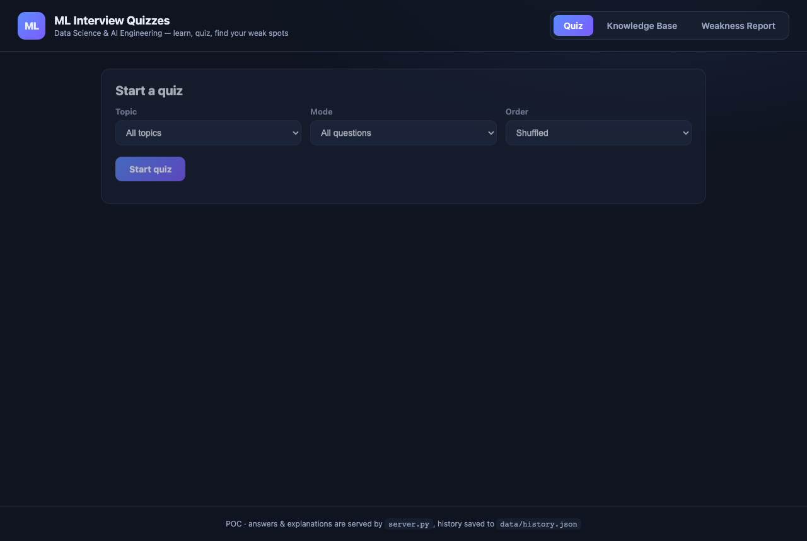
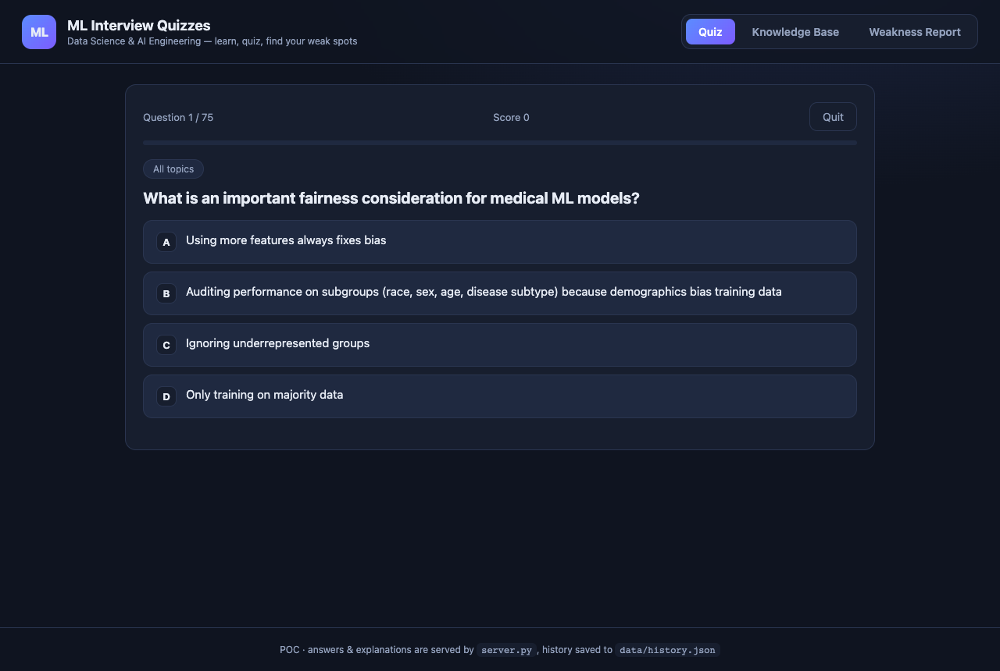
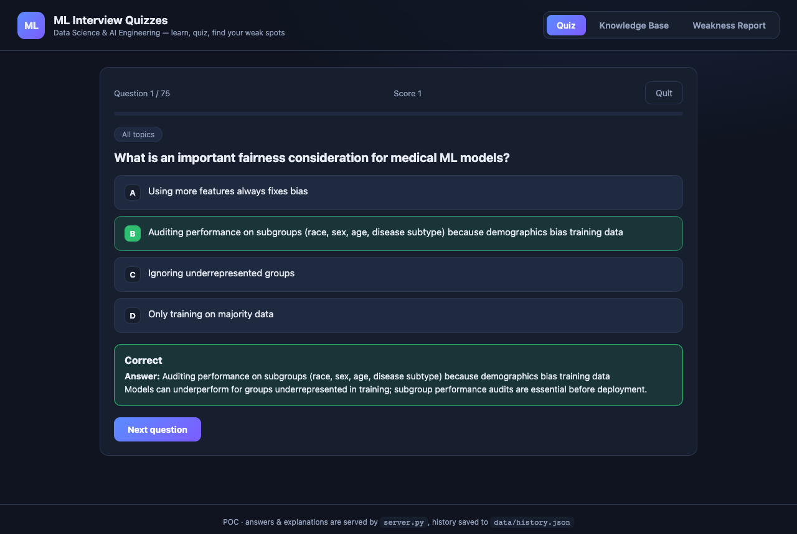
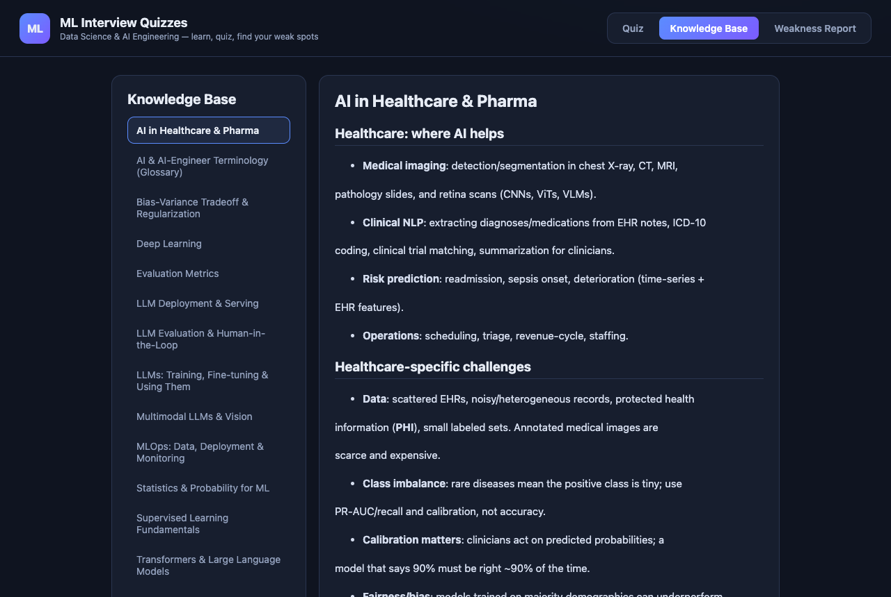
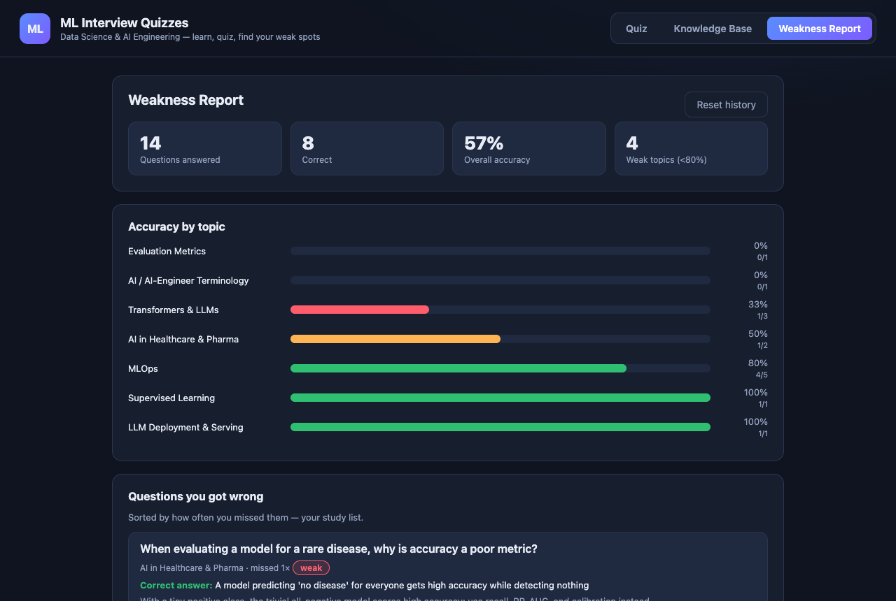

# ML Interview Quizzes — POC

A dependency-free quiz app to self-test machine-learning knowledge for
**data scientists / AI engineers**, plus a browsable knowledge base and a
weakness report that tracks every question you miss.

## What's inside

```
corpus/            Knowledge base (Markdown notes, 15 topics)
data/questions.json  75 multiple-choice questions (4 options each)
data/history.json    Your answer history (created on first answer)
server.py         Python stdlib HTTP server + JSON API (no pip installs)
web/              Single-page app (vanilla JS/CSS)
screenshots/      Preview images used below
```

## Using the app

The app has three tabs. Start a quiz, read a topic, or check your weakness
report — all from one page.

### 1. Quiz — configure and start

Pick a **topic** (or *All topics*), a **mode**, and an **order**, then hit
**Start quiz**. Mode `Only unseen` hides questions you've already answered;
`Only previously wrong` gives you a targeted re-quiz of your misses.



### 2. Quiz — answer one at a time

Questions appear **one at a time** in a shuffled order. Your running score and
progress bar are shown at the top.



### 3. Instant feedback + explanation

After you pick an answer, the correct option is highlighted (green), your miss
is marked (red), and a **short explanation** appears before you move on.



### 4. Knowledge base

The **Knowledge Base** tab lists every topic. Click one to read the notes the
questions are drawn from.



### 5. Weakness Report — your misses

Every wrong answer is collected. The **Weakness Report** shows your overall
stats, accuracy per topic, and every missed question (with the correct answer
and explanation) so you can see exactly where to focus.



## Features

- **Quiz**: pick a topic (or all) and a mode — *all*, *only unseen*, or
  *only previously wrong*. Questions are shuffled and shown **one at a time**.
- **Immediate feedback**: on answering, the correct option is highlighted and a
  **short explanation** appears.
- **Wrong-answer collection**: every attempt is stored; the **Weakness Report**
  aggregates accuracy per topic and lists each missed question with the correct
  answer + explanation.
- **Knowledge base**: read the notes behind each topic in-app (Markdown is
  rendered server-side).

## Run it

Requires only Python 3.10+ (uses the standard library).

```bash
./run.sh            # or: python3 server.py
```

Then open <http://127.0.0.1:8000>.

Custom port:

```bash
python3 server.py --port 9000
```

## API (for reference)

| Method | Path | Purpose |
|---|---|---|
| GET  | `/api/topics` | list topics |
| GET  | `/api/quiz?topic=<slug>&mode=all\|unseen\|wrong` | fetch questions (answers stripped) |
| POST | `/api/submit` | `{question_id, choice}` → correctness, answer, explanation |
| GET  | `/api/weakness` | aggregated accuracy + wrong-question list |
| GET  | `/api/history` | raw attempt log |
| POST | `/api/reset` | clear history |
| GET  | `/api/corpus` / `/api/corpus/<slug>` | knowledge-base index / article |

Correct answers are kept **server-side** and only revealed after you submit.

## Adding content

- **Questions**: append to `data/questions.json`. Each item needs
  `id`, `topic`, `options` (exactly 4), `answer` (0-3), `explanation`.
- **Notes**: drop a new `*.md` file in `corpus/` and add a matching topic entry
  in `data/questions.json`.

## Notes / limitations

This is a POC: history is stored in a plain JSON file (single user, no auth).
Swap `load_history`/`save_history` in `server.py` for a database to go
multi-user.
